[](https://opensource.org/licenses/Apache-2.0)

# Newton with SolverFBA

This branch of [Newton](https://github.com/newton-physics/newton) adds `SolverFBA`, a solver for cloth and
volumetric soft bodies with robust frictional contact, after the paper
[*Fast But Accurate: A Real-Time Hyperelastic Simulator with Robust Frictional Contact*](https://doi.org/10.1145/3730834)
(ACM Transactions on Graphics 44(4), 2025). It is based on Newton `main` at
[`b09a2214`](https://github.com/newton-physics/newton/commit/b09a22143be8015d18491e1df5d3fc147add791d)
(2026-05-14); everything outside `SolverFBA` and its examples is upstream Newton.

<p align="center">
  
  <br>
  <sub>Clockwise from top left: <code>cloth_dual_franka_fba</code> (1.65x speed), <code>shirt_fold_fba</code> (3.75x),
  <code>pneunet_gripper_fba</code> (1.1x), <code>cloth_on_knives_fba</code> (0.5x). Rendered with Newton's OpenGL viewer.</sub>
</p>

## SolverFBA

`SolverFBA` steps the elastic bodies with projective dynamics: each step runs a fixed number of local-global
iterations, the local phase projects every element onto its constraint set, and the global phase solves with a
system matrix that is factored once. Contacts are complementarity conditions: each iteration takes one semismooth
Newton step of the contact and constraint multipliers, so contacts do not penetrate and need no contact stiffness.

- **Cloth**: ARAP, corotational, or Neo-Hookean stretching and isometric bending.
- **Soft bodies**: tetrahedra with the same stretching models; tetrahedron activations grow or shrink them, as the
  chambers of a pneumatic actuator lengthen.
- **Frictional contact**: particle and face contacts on shapes, cloth self-contact with vertex-face and edge-edge
  contacts, friction anchors that keep stacked layers from creeping apart, and a contact warm start.
- **Damping**: implicit Rayleigh damping, per particle if needed.
- **Constraints**: pinned particles with moving targets, and rows that hold lengths or linear combinations of
  particle positions, such as cables through a soft body or the cloth a gripper holds.
- **Rigid bodies**: rigid bodies with bilateral joints, or bodies that another Newton solver integrates.
- **Devices**: CUDA and CPU.

`SolverFBA` is experimental: its API and behavior may change. The
[FBA solver guide](https://pranalabs.github.io/newton/fba/solvers/fba.html) covers its inputs, contact options, and limitations, and the
[API reference](https://pranalabs.github.io/newton/fba/api/_generated/newton.solvers.SolverFBA.html) its parameters.

## Requirements

- **Python** 3.10+
- **OS:** Linux (x86-64, aarch64), Windows (x86-64), or macOS (CPU only)
- **GPU:** Warp 1.18, which requires an NVIDIA Turing GPU (compute capability 7.5+) and driver R580+ for CUDA
  acceleration. No local CUDA Toolkit is required; macOS runs on CPU.

## Installation

`SolverFBA` is not in the `newton` package on PyPI. Install this branch from source:

```bash
git clone -b ziqiu/fba-solver https://github.com/PranaLabs/newton.git
cd newton
uv run --extra examples -m newton.examples cloth_dual_franka_fba
```

or, without [uv](https://docs.astral.sh/uv/), in a virtual environment:

```bash
pip install -e ".[examples]"
python -m newton.examples cloth_dual_franka_fba
```

## Quickstart

A cloth dropped on the ground:

```python
import warp as wp

import newton

builder = newton.ModelBuilder()
builder.add_ground_plane()
builder.add_cloth_grid(
    pos=wp.vec3(-0.5, -0.5, 0.5),
    rot=wp.quat_identity(),
    vel=wp.vec3(0.0),
    dim_x=20,
    dim_y=20,
    cell_x=0.05,
    cell_y=0.05,
    mass=0.005,
    tri_ke=1.0e4,
    edge_ke=1.0e-4,
    particle_radius=0.005,
)
model = builder.finalize()

solver = newton.solvers.SolverFBA(model, iterations=10)
pipeline = newton.CollisionPipeline(model, soft_contact_gap=0.01)
contacts = pipeline.contacts()
state_0, state_1 = model.state(), model.state()

for _ in range(120):
    pipeline.collide(state_0, contacts)
    solver.step(state_0, state_1, None, contacts, 1.0 / 60.0)
    state_0, state_1 = state_1, state_0
```

The first step factors the system matrix on the CPU and takes longer than the others.

## Examples

Each example below runs with `python -m newton.examples <name>`, or with
`uv run --extra examples -m newton.examples <name>` from a uv checkout. The examples that come with upstream Newton
are still in the package; `python -m newton.examples --list` lists them all.

<table>
  <tr>
    <td colspan="3"><h3>Robot Manipulation</h3></td>
  </tr>
  <tr>
    <td align="center" width="33%">
      <a href="newton/examples/cloth/example_cloth_dual_franka_fba.py">
        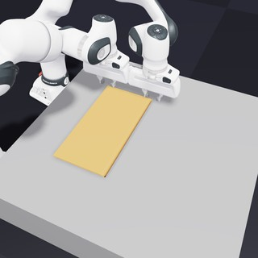
      </a>
    </td>
    <td align="center" width="33%">
      <a href="newton/examples/cloth/example_shirt_fold_fba.py">
        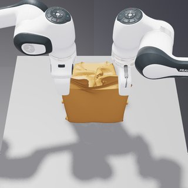
      </a>
    </td>
    <td align="center" width="33%">
      <a href="newton/examples/softbody/example_softbody_franka_fba.py">
        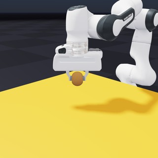
      </a>
    </td>
  </tr>
  <tr>
    <td align="center" width="33%">
      <code>python -m newton.examples cloth_dual_franka_fba</code><br>
      <sub>two Franka arms fold a towel twice into a square</sub>
    </td>
    <td align="center" width="33%">
      <code>python -m newton.examples shirt_fold_fba</code><br>
      <sub>two Franka arms fold a T-shirt dropped on a table</sub>
    </td>
    <td align="center" width="33%">
      <code>python -m newton.examples softbody_franka_fba</code><br>
      <sub>a Franka arm picks up a soft ball held by friction alone</sub>
    </td>
  </tr>
  <tr>
    <td align="center" width="33%">
      <a href="newton/examples/softbody/example_pneunet_gripper_fba.py">
        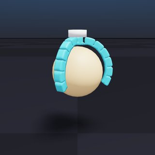
      </a>
    </td>
    <td align="center" width="33%">
      <a href="newton/examples/softbody/example_cable_gripper_fba.py">
        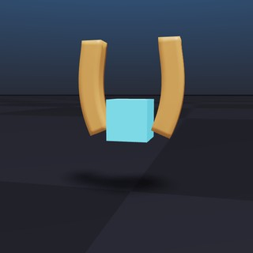
      </a>
    </td>
    <td align="center" width="33%">
      <a href="newton/examples/softbody/example_claw_machine_fba.py">
        
      </a>
    </td>
  </tr>
  <tr>
    <td align="center" width="33%">
      <code>python -m newton.examples pneunet_gripper_fba</code><br>
      <sub>a pneumatic three-finger gripper closes around a ball</sub>
    </td>
    <td align="center" width="33%">
      <code>python -m newton.examples cable_gripper_fba</code><br>
      <sub>soft fingers curled by embedded cables lift a box</sub>
    </td>
    <td align="center" width="33%">
      <code>python -m newton.examples claw_machine_fba</code><br>
      <sub>a claw picks a toy out of a pile of 25 soft toys</sub>
    </td>
  </tr>
  <tr>
    <td colspan="3"><h3>Cloth</h3></td>
  </tr>
  <tr>
    <td align="center" width="33%">
      <a href="newton/examples/cloth/example_stretching_cloth_fba.py">
        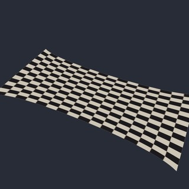
      </a>
    </td>
    <td align="center" width="33%">
      <a href="newton/examples/cloth/example_shirt_pins_fba.py">
        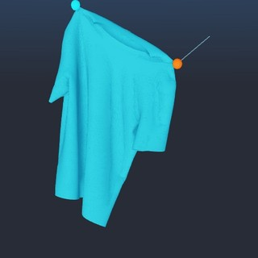
      </a>
    </td>
    <td align="center" width="33%">
      <a href="newton/examples/multiphysics/example_cloth_on_knives_fba.py">
        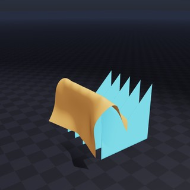
      </a>
    </td>
  </tr>
  <tr>
    <td align="center" width="33%">
      <code>python -m newton.examples stretching_cloth_fba</code><br>
      <sub>Neo-Hookean cloth pulled apart by pins on two opposite edges</sub>
    </td>
    <td align="center" width="33%">
      <code>python -m newton.examples shirt_pins_fba</code><br>
      <sub>a T-shirt moved by two handles at its shoulders, with self-contact</sub>
    </td>
    <td align="center" width="33%">
      <code>python -m newton.examples cloth_on_knives_fba</code><br>
      <sub>cloth dropped on notched blades, held off their tips by face contacts</sub>
    </td>
  </tr>
  <tr>
    <td align="center" width="33%">
      <a href="newton/examples/multiphysics/example_cloth_on_boxes_fba.py">
        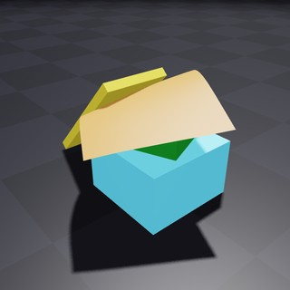
      </a>
    </td>
    <td align="center" width="33%">
    </td>
    <td align="center" width="33%">
    </td>
  </tr>
  <tr>
    <td align="center" width="33%">
      <code>python -m newton.examples cloth_on_boxes_fba</code><br>
      <sub>cloth on stacked boxes and a hinged plank that tips onto them</sub>
    </td>
    <td align="center" width="33%">
    </td>
    <td align="center" width="33%">
    </td>
  </tr>
  <tr>
    <td colspan="3"><h3>Soft Bodies</h3></td>
  </tr>
  <tr>
    <td align="center" width="33%">
      <a href="newton/examples/softbody/example_twisting_bar_fba.py">
        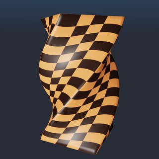
      </a>
    </td>
    <td align="center" width="33%">
      <a href="newton/examples/softbody/example_squeezing_ball_fba.py">
        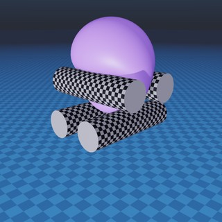
      </a>
    </td>
    <td align="center" width="33%">
      <a href="newton/examples/softbody/example_softbody_cantilever_fba.py">
        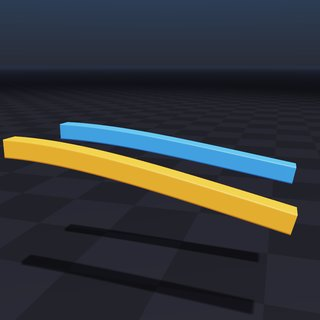
      </a>
    </td>
  </tr>
  <tr>
    <td align="center" width="33%">
      <code>python -m newton.examples twisting_bar_fba</code><br>
      <sub>a stiff Neo-Hookean bar (E = 1 GPa) twisted by its pinned ends</sub>
    </td>
    <td align="center" width="33%">
      <code>python -m newton.examples squeezing_ball_fba</code><br>
      <sub>a soft ball dragged through spinning cylinders by friction</sub>
    </td>
    <td align="center" width="33%">
      <code>python -m newton.examples softbody_cantilever_fba</code><br>
      <sub>two soft beams, one with Rayleigh damping</sub>
    </td>
  </tr>
  <tr>
    <td align="center" width="33%">
      <a href="newton/examples/softbody/example_bunny_ears_fba.py">
        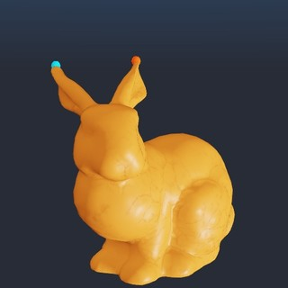
      </a>
    </td>
    <td align="center" width="33%">
    </td>
    <td align="center" width="33%">
    </td>
  </tr>
  <tr>
    <td align="center" width="33%">
      <code>python -m newton.examples bunny_ears_fba</code><br>
      <sub>a soft bunny carried and swung by its ear tips</sub>
    </td>
    <td align="center" width="33%">
    </td>
    <td align="center" width="33%">
    </td>
  </tr>
</table>

### Performance

Mean time per frame of each example over the frames of its test run, after 10 warm-up frames, without rendering
(`--viewer null`), on one NVIDIA GeForce RTX 5090, at `ziqiu/fba-solver` `1902ddf0`. Real time is the simulated
time per wall-clock time. The claw machine is timed over its first 300 frames, while the toys fall and settle.

| Example | Particles | Triangles | Tetrahedra | Frame | ms per frame | Real time |
| --- | ---: | ---: | ---: | ---: | ---: | ---: |
| `cloth_dual_franka_fba` | 1,681 | 3,200 | 0 | 1/60 s | 23.0 | 0.73x |
| `shirt_fold_fba` | 6,480 | 12,748 | 0 | 1/60 s | 17.9 | 0.93x |
| `softbody_franka_fba` | 2,197 | 1,728 | 10,368 | 1/60 s | 25.7 | 0.65x |
| `pneunet_gripper_fba` | 7,363 | 9,612 | 27,395 | 1/100 s | 64.6 | 0.15x |
| `cable_gripper_fba` | 1,050 | 1,408 | 3,200 | 1/100 s | 29.1 | 0.34x |
| `claw_machine_fba` | 87,982 | 131,566 | 305,339 | 1/30 s | 455.7 | 0.07x |
| `stretching_cloth_fba` | 20,201 | 40,000 | 0 | 1/100 s | 6.0 | 1.67x |
| `shirt_pins_fba` | 7,931 | 15,650 | 0 | 1/60 s | 17.8 | 0.93x |
| `cloth_on_knives_fba` | 5,101 | 10,000 | 0 | 1/100 s | 32.1 | 0.31x |
| `cloth_on_boxes_fba` | 289 | 512 | 0 | 1/60 s | 28.9 | 0.58x |
| `twisting_bar_fba` | 11,340 | 5,780 | 58,956 | 1/100 s | 8.6 | 1.16x |
| `squeezing_ball_fba` | 6,859 | 3,888 | 34,992 | 1/100 s | 15.4 | 0.65x |
| `softbody_cantilever_fba` | 10,584 | 6,760 | 43,940 | 1/50 s | 13.5 | 1.48x |
| `bunny_ears_fba` | 4,155 | 5,294 | 15,844 | 1/60 s | 5.9 | 2.82x |

### Example Options

All examples share a common set of command-line options. The most commonly used ones are:

| Argument        | Description                                                              | Default                      |
| --------------- | ------------------------------------------------------------------------ | ---------------------------- |
| `--viewer`      | Viewer to use: `gl`, `usd`, `rtx`, `rerun`, `viser`, or `null`.          | `gl`                         |
| `--device`      | Compute device to use, e.g., `cpu`, `cuda:0`.                            | `None` (default Warp device) |
| `--num-frames`  | Total number of frames to simulate.                                      | `100`                        |
| `--output-path` | Path to the output USD file (used by the `usd` viewer).                  | `output.usd`                 |

For the complete, always-current list of options — plus any arguments a specific example adds — run:

```bash
python -m newton.examples <example_name> --help
```

### Example Usage

```bash
# List available examples
python -m newton.examples --list

# Run with the USD viewer and save to my_output.usd
python -m newton.examples cloth_dual_franka_fba --viewer usd --output-path my_output.usd

# Run on a selected device
python -m newton.examples shirt_fold_fba --device cuda:0

# Combine options
python -m newton.examples twisting_bar_fba --viewer gl --num-frames 500 --device cpu
```

## Citation

If you use `SolverFBA` in your research, please cite:

```bibtex
@article{Zeng2025FBA,
  title   = {Fast But Accurate: A Real-Time Hyperelastic Simulator with Robust Frictional Contact},
  author  = {Zeng, Ziqiu and Luo, Siyuan and Shi, Fan and Zhang, Zhongkai},
  journal = {ACM Transactions on Graphics},
  volume  = {44},
  number  = {4},
  pages   = {1--19},
  year    = {2025},
  doi     = {10.1145/3730834},
}
```

## Newton

Newton is a GPU-accelerated physics simulation engine built upon [NVIDIA Warp](https://github.com/NVIDIA/warp) and
a [Linux Foundation](https://www.linuxfoundation.org/) project; see the
[Newton repository](https://github.com/newton-physics/newton) and its
[documentation](https://newton-physics.github.io/newton/latest/guide/overview.html) for everything else. Code is
licensed under [Apache-2.0](LICENSE.md). Documentation is licensed under
[CC-BY-4.0](https://creativecommons.org/licenses/by/4.0/). Additional and third-party license texts are available in
[`newton/licenses`](newton/licenses).
